# PLL Studio v0.1.1

<p align="center">
  
</p>

<p align="center">
  <a href="https://github.com/maximkurein/PLL-Studio/actions/workflows/ci.yml"></a>
  <a href="LICENSE"></a>
  
  
  
  
</p>

<p align="center">
  <a href="#быстрый-старт"><strong>Быстрый старт</strong></a>
  &nbsp;·&nbsp; <a href="#галерея">Галерея</a>
  &nbsp;·&nbsp; <a href="#как-работает-синтезатор">Как работает синтезатор</a>
  &nbsp;·&nbsp; <a href="#подключение-к-плате">Подключение</a>
  &nbsp;·&nbsp; <a href="BUILD.md">Сборка</a>
  &nbsp;·&nbsp; <a href="docs/INDEX_ru.md">Документация</a>
</p>

PLL Studio — настольное приложение для macOS и Windows (плюс веб-режим) для работы с платой **8V9705x EVB** и изучения всех технологий микросхемы **8V97051**: дробного синтеза частоты (Frac-N, ΣΔ), петли ФАПЧ, автокалибровки ГУН, детектора захвата, Fast Lock / Phase Resync, SPI-интерфейса и регистров. Вся инженерная модель написана на Rust; интерфейс — React + Tailwind в оболочке Tauri 2.

Если платы под рукой нет — встроенный **симулятор кристалла** ведёт себя как настоящий: двойная буферизация регистров, калибровка ГУН с таймингом, захват петли, чтение регистров через MUX_OUT, sticky-флаги, температурный дрейф.

<p align="center">
  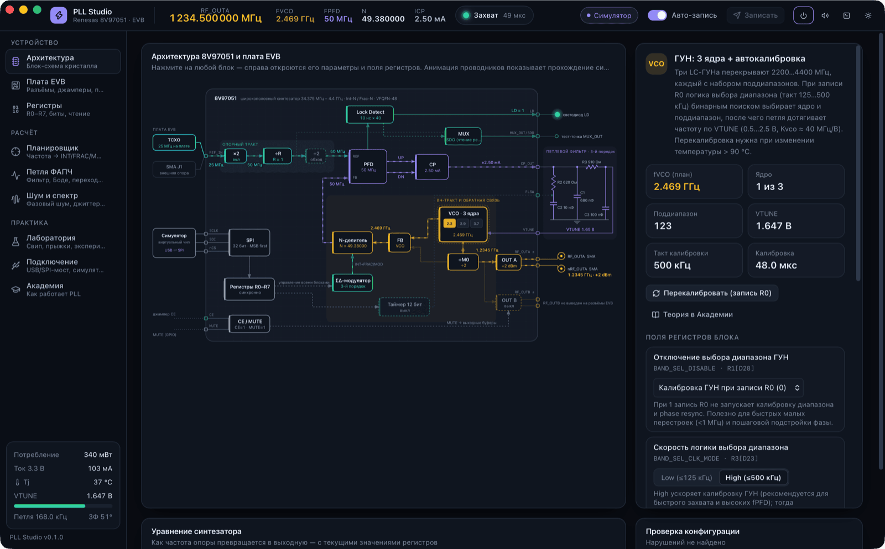
</p>
<p align="center"><sub><b>Архитектура</b> — живая блок-схема кристалла и платы. Частоты на проводниках, активное ядро ГУН, VTUNE и захват обновляются в реальном времени; щелчок по блоку открывает его параметры, поля регистров и теорию.</sub></p>

## Три сценария

| | Сценарий | Как |
|---|---|---|
| 🔌 | **Запустить плату за 5 минут** | Плата → Подключение → Планировщик: введите частоту, нажмите «Применить» — программа запишет R7→R0 и включит RF_OUTA. Подробно — [первый запуск](docs/FIRST_RUN_ru.md). |
| 📐 | **Спроектировать петлю** | «Петля ФАПЧ»: впишите фактические номиналы фильтра или рассчитайте новые под нужную полосу; посмотрите Боде, переходный процесс, джиттер и спуры до того, как паять. |
| 🎓 | **Изучить микросхему** | «Архитектура» объясняет каждый блок, «Академия» — 11 уроков с кнопками «попробуйте сами», которые меняют конфигурацию на лету. |

## Галерея

<table>
  <tr>
    <td width="50%" valign="top">
      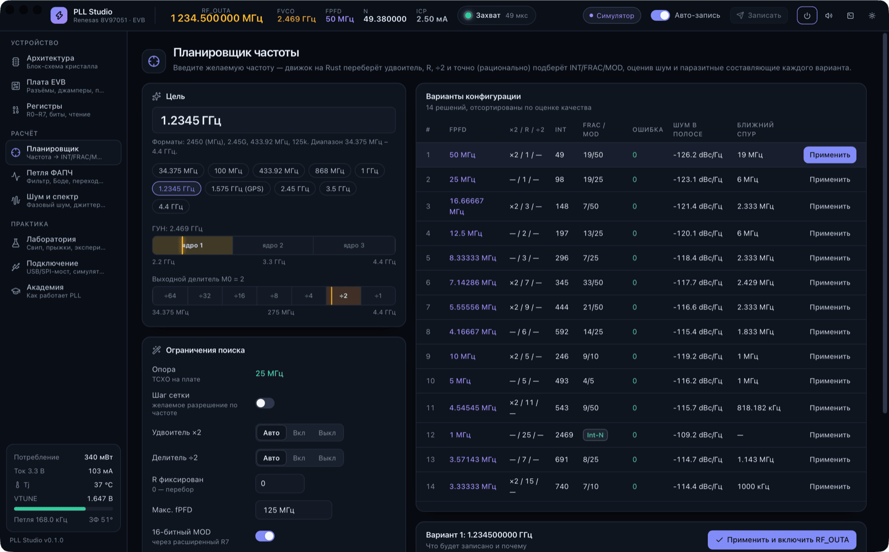<br>
      <b>Планировщик частоты.</b> Точный рациональный перебор ×2 / R / ÷2 / INT / FRAC / MOD / M0 с оценкой шума в полосе и ближнего спура для каждого варианта.
    </td>
    <td width="50%" valign="top">
      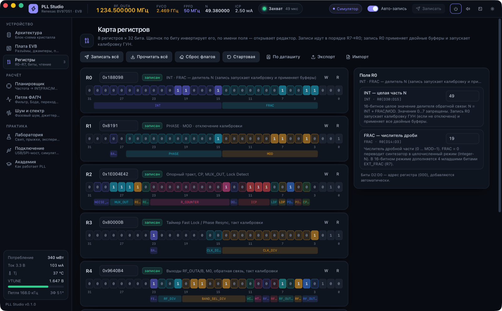<br>
      <b>Регистры R0–R7 по битам.</b> Щелчок по биту, редакторы полей с описаниями, hex-ввод, запись и чтение, сравнение readback, экспорт/импорт.
    </td>
  </tr>
  <tr>
    <td width="50%" valign="top">
      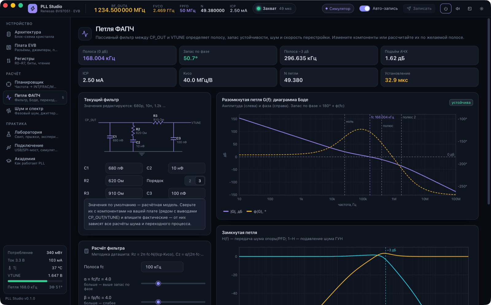<br>
      <b>Петля ФАПЧ.</b> Расчёт фильтра 2-го/3-го порядка по методике даташита (E12/E24), Боде разомкнутой петли, замкнутая петля, нелинейный переходный процесс.
    </td>
    <td width="50%" valign="top">
      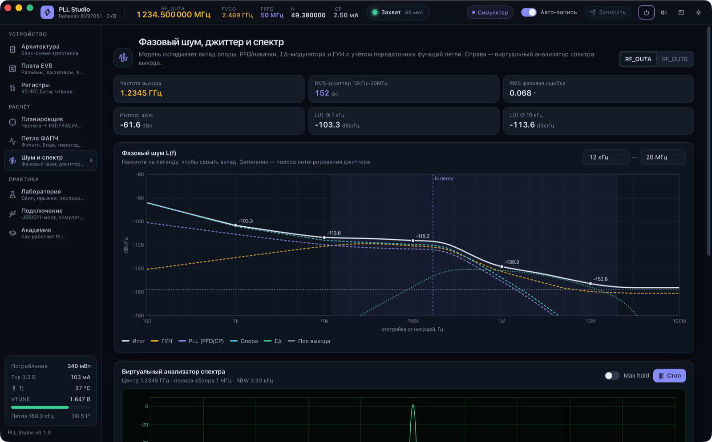<br>
      <b>Фазовый шум и джиттер.</b> Вклад опоры, PFD/накачки, ΣΔ, ГУН и выходного пола; RMS-джиттер в выбранной полосе.
    </td>
  </tr>
  <tr>
    <td width="50%" valign="top">
      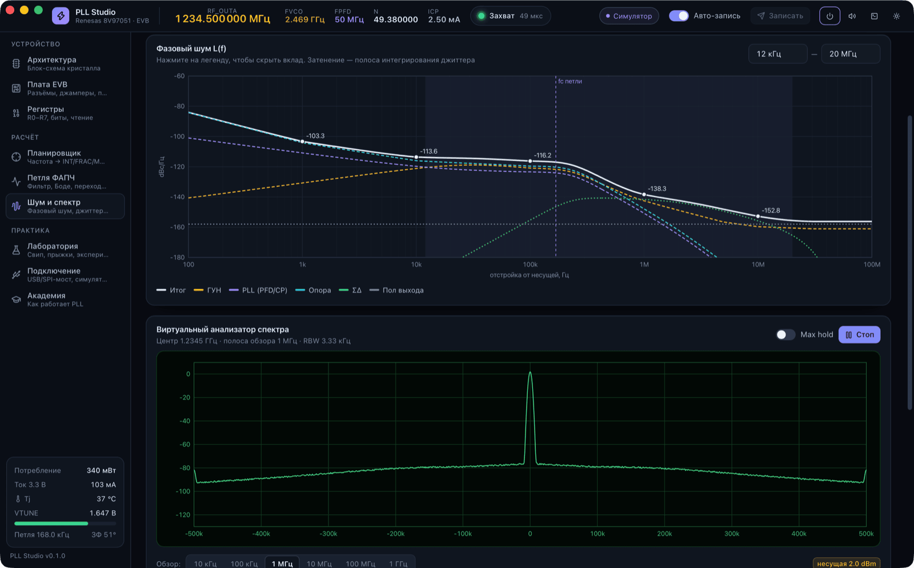<br>
      <b>Виртуальный анализатор спектра.</b> Несущая, шум и спуры в реальном времени, полосы обзора от 10 кГц до 1 ГГц, Max hold.
    </td>
    <td width="50%" valign="top">
      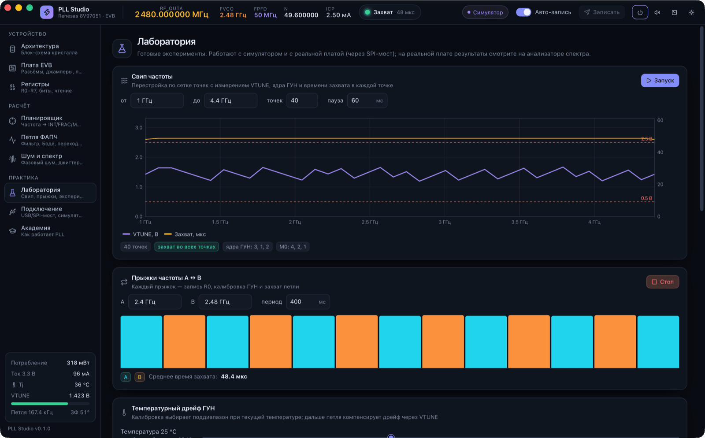<br>
      <b>Лаборатория.</b> Свип 1–4.4 ГГц (VTUNE, ядро ГУН, время захвата), прыжки A↔B, температурный дрейф, сдвиг фазы, внедрение отказов.
    </td>
  </tr>
  <tr>
    <td width="50%" valign="top">
      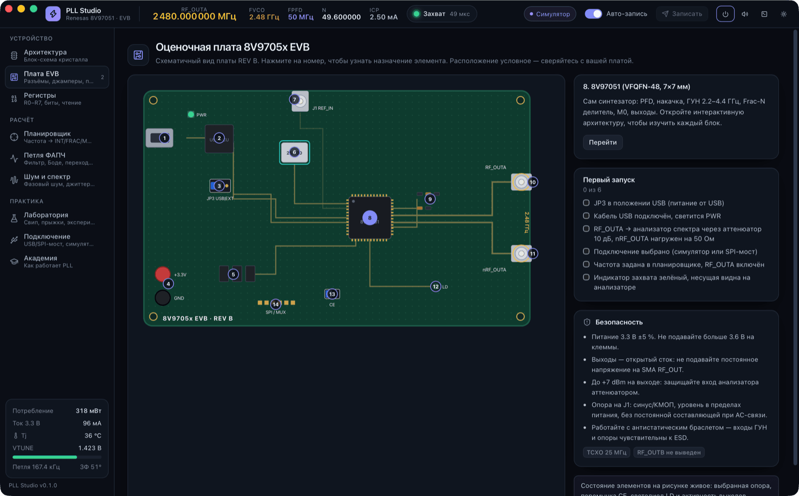<br>
      <b>Плата EVB.</b> Схематичный вид Rev A (2015) с пояснениями к разъёмам и перемычкам, чек-лист первого запуска и правила безопасности.
    </td>
    <td width="50%" valign="top">
      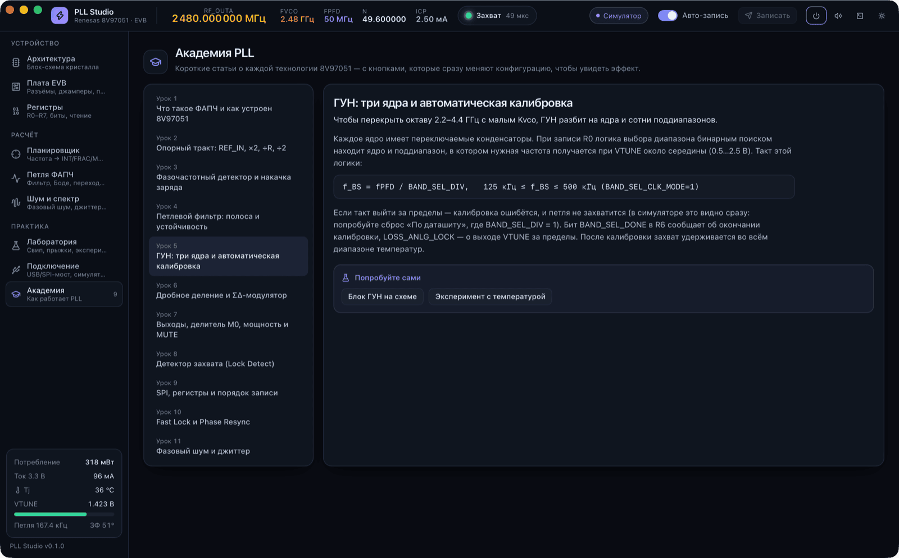<br>
      <b>Академия.</b> 11 коротких уроков — от опорного тракта до шума и джиттера — с формулами и кнопками «попробуйте сами».
    </td>
  </tr>
</table>

<details>
<summary><b>Светлая тема</b></summary>
<br>
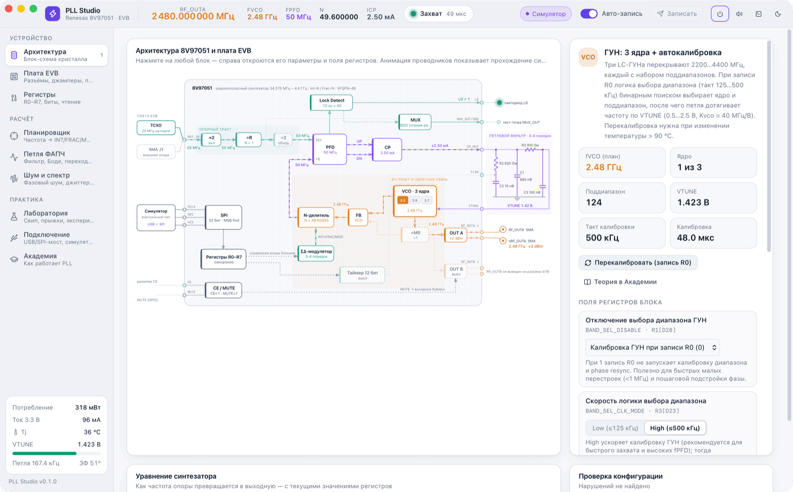
</details>

## Как работает синтезатор

<p align="center">
  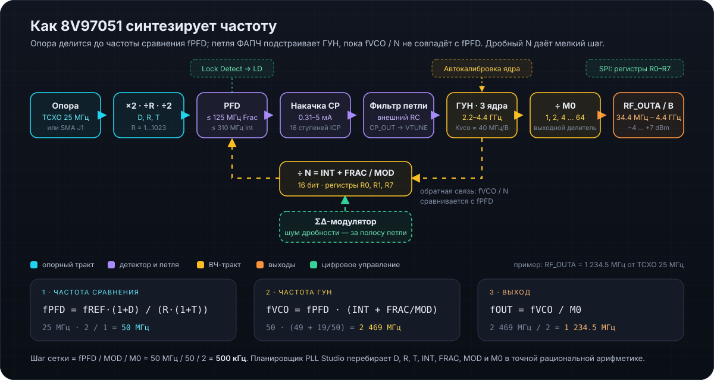
</p>

Опорный сигнал (TCXO 25 МГц на плате или внешний через SMA J1) проходит удвоитель, делитель R и делитель на 2 — получается частота сравнения **fPFD**. Фазочастотный детектор сравнивает её с частотой ГУН, делённой на **N = INT + FRAC/MOD**, а накачка и внешний фильтр превращают ошибку в напряжение VTUNE. Петля подстраивает ГУН (2.2–4.4 ГГц, три ядра с автокалибровкой), пока частоты не совпадут; выходной делитель M0 опускает частоту до 34 МГц. ΣΔ-модулятор делает N дробным и уносит шум дробности за полосу петли.

В приложении это видно на каждом шаге: «Архитектура» показывает частоты на проводниках, «Планировщик» подбирает делители, «Академия» объясняет каждый блок.

## Возможности

| Раздел | Что внутри |
|---|---|
| **Архитектура** | Анимированная блок-схема 8V97051 и элементов EVB (TCXO, SMA, петлевой фильтр, LED). Частоты на проводниках, состояние ядер ГУН, VTUNE, LD. Инспектор блока с полями регистров и проверкой ограничений даташита. |
| **Плата EVB** | Схематичный вид платы Rev A (2015) с пояснениями к разъёмам и перемычкам, чек-лист первого запуска, правила безопасности. |
| **Регистры** | Карта R0–R7 по битам: щелчок по биту, редакторы полей, hex-ввод, запись/чтение по одному регистру, сравнение readback, sticky-флаги, экспорт/импорт конфигурации. |
| **Планировщик** | Точный (рациональный, без ошибок округления) подбор ×2 / R / ÷2 / INT / FRAC / MOD / M0 с оценкой шума в полосе и ближних спуров каждого варианта; быстрая перестройка ±шаг. |
| **Петля ФАПЧ** | Расчёт фильтра 2-го/3-го порядка (методика даташита, ряды E12/E24), Боде разомкнутой петли, замкнутая петля, нелинейный переходный процесс с проскальзыванием циклов и Lock Detect. |
| **Шум и спектр** | Вклад опоры, PFD/накачки, ΣΔ, ГУН и выходного пола; RMS-джиттер в заданной полосе; таблица спуров; виртуальный анализатор спектра с Max hold. |
| **Лаборатория** | Свип частоты (VTUNE, ядро ГУН, время захвата), прыжки A↔B, температурный дрейф, сдвиг фазы, внедрение отказов (CP Hi-Z, MTLD, POWER_DOWN, SPI-ошибка). |
| **Подключение** | Симулятор, штатный USB EVB (экспериментально) или последовательный SPI-мост; сканер USB. Доступность CE / MUTE / LD зависит от транспорта. |
| **SPI-консоль** | ⌘/Ctrl + J — каждый 32-битный кадр с расшифровкой изменённых полей, произвольная отправка слова. |

## Быстрый старт

**Нужно:** [Rust](https://rustup.rs) (stable), [Node.js](https://nodejs.org) 20+, на macOS — Xcode Command Line Tools, на Windows — Visual Studio Build Tools (C++) и WebView2 (уже есть в Windows 10/11).

macOS:

```bash
git clone https://github.com/maximkurein/PLL-Studio.git
cd PLL-Studio
npm ci
npm run app          # desktop-приложение с hot reload
```

Windows (PowerShell):

```powershell
git clone https://github.com/maximkurein/PLL-Studio.git
cd PLL-Studio
npm ci
npm run app
```

Веб-режим (браузер, «удалённая лаборатория» — например, плата подключена к другому компьютеру):

```bash
npm run web          # собрать фронтенд и запустить сервер на http://127.0.0.1:7878
```

Горячие клавиши: <kbd>⌘</kbd>/<kbd>Ctrl</kbd> + <kbd>1</kbd>…<kbd>9</kbd> — экраны в порядке бокового меню; <kbd>⌘</kbd>/<kbd>Ctrl</kbd> + <kbd>0</kbd> — «О программе»; <kbd>⌘</kbd>/<kbd>Ctrl</kbd> + <kbd>J</kbd> — SPI-консоль. Все команды проекта: `make help`.

Экран **«О программе»** показывает версию, дату выпуска, разработчика, лицензию и текущее подключение. Открывается также кнопкой ℹ в верхней панели и нажатием на версию внизу меню. Ссылки GitHub и Forgejo открываются в браузере; команды `git clone` копируются одним нажатием. Сведения поступают из ядра через `get_meta.app`, их единственный источник — `config/version.json`.

## Подключение к плате

<p align="center">
  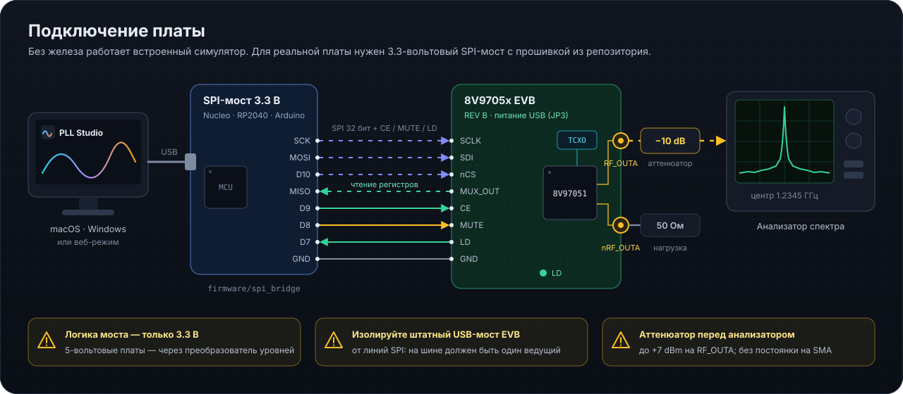
</p>

PLL Studio поддерживает три варианта подключения:

- **Симулятор** — по умолчанию, ничего подключать не нужно.
- **Штатный USB EVB (экспериментально)** — FT2232 → I²C → SC18IS602 → SPI, без внешней платы. Поддержаны запись и readback, CE/MUTE остаются на JP2/JP1. [Подключение и USB-драйверы](docs/NATIVE_USB_ru.md).
- **Последовательный SPI-мост** — любая 3.3-вольтовая плата (Nucleo, RP2040, Arduino 3.3 В) с прошивкой [`firmware/spi_bridge`](firmware/spi_bridge/spi_bridge.ino). Схема и протокол — [SPI_BRIDGE_ru.md](docs/SPI_BRIDGE_ru.md).
- **Сканер USB** — показывает дескрипторы; «Найти EVB» предлагает FT2232-кандидатов. Выбор платы выполняется пользователем.

> [!WARNING]
> Логика SPI-моста — **только 3.3 В**. Перед подключением внешнего моста изолируйте штатный USB-контроллер EVB от линий SPI. Защищайте вход анализатора спектра аттенюатором. Подробнее — [SECURITY.md](SECURITY.md#безопасность-железа).

## Архитектура программы

<p align="center">
  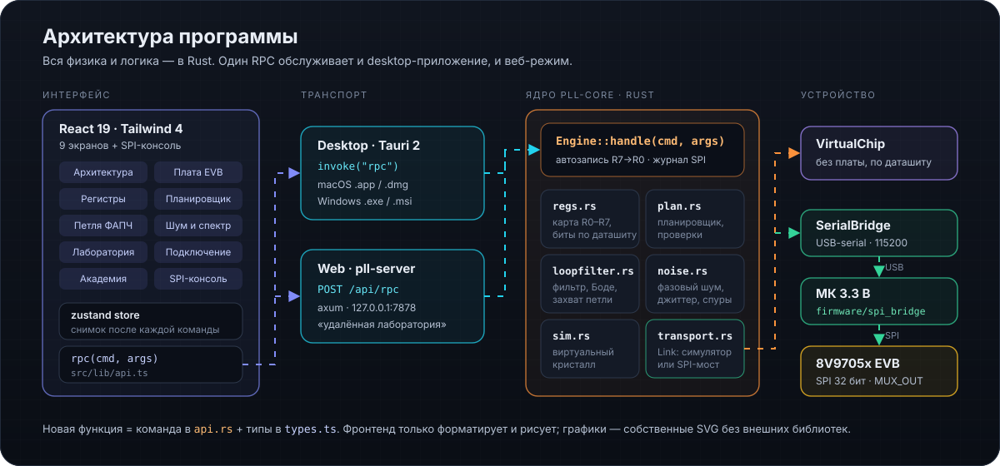
</p>

```text
crates/pll-core     модель 8V97051 на Rust: регистры, планировщик, петля, шум, симулятор, транспорт, RPC
crates/pll-server   HTTP-сервер (axum): тот же RPC + раздача интерфейса — веб-режим
src-tauri           desktop-оболочка Tauri 2 (macOS / Windows)
src                 интерфейс: React 19, Tailwind 4, zustand, собственные SVG-графики
firmware            прошивка последовательного SPI-моста
tools               управление версией
config/version.json единственный источник версии
```

Подробнее — [ARCHITECTURE_ru.md](docs/ARCHITECTURE_ru.md).

## Сборка и версии

| Задача | Команда |
|---|---|
| macOS `.app` + `.dmg` | `python3 build_macos.py` (`--universal` — Intel + Apple Silicon) |
| Windows `.exe` + `.msi` | `.\build_windows.ps1` или `build_windows.bat` |
| Проверка перед коммитом | `make check` |
| Текущая версия | `python3 tools/update_version.py status` |
| Новая версия | `python3 tools/update_version.py bump patch` (`minor`, `major`) |

Готовые сборки складываются в `release/vX.Y.Z/` вместе с `checksum.txt`. Тег `vX.Y.Z` запускает GitHub Actions и собирает черновик релиза для macOS и Windows. Подробнее — [BUILD.md](BUILD.md) и [VERSION_MANAGEMENT.md](VERSION_MANAGEMENT.md).

## Документация

- [Индекс документации](docs/INDEX_ru.md)
- [Первый запуск с платой](docs/FIRST_RUN_ru.md)
- [SPI-мост: прошивка, схема, протокол](docs/SPI_BRIDGE_ru.md)
- [Архитектура кода](docs/ARCHITECTURE_ru.md)
- [Сборка](BUILD.md) · [Управление версией](VERSION_MANAGEMENT.md) · [Выпуск релиза](docs/release_guide_ru.md)
- [Изменения](CHANGELOG.md) · [Безопасность](SECURITY.md)

## Ограничения

- Модели шума, спуров и переходных процессов — инженерные оценки по даташиту, а не замена измерениям. Сверяйте результат с анализатором спектра.
- Новые настройки используют номиналы EVB Rev A; сверьте их с монтажом своей платы. Сохранённые настройки автоматически не заменяются.
- RF_OUTB на плате EVB не разведён на разъёмы.
- Штатный USB-транспорт реализован по схеме Rev A и документированным протоколам, на физической EVB подтверждены запись и readback R0–R7, DEV_ID и перестановка INT=100→101→100. Для чтения нужна замкнутая цепь R2 (на схеме NP); тест проведён с временной перемычкой. RF-параметры измерительными приборами пока не проверены. Обмен через GPIO FT2232 медленный; для быстрых свипов используйте внешний SPI-мост. Windows требует WinUSB на канале A.

## Репозитории

- [GitHub — основной репозиторий](https://github.com/maximkurein/PLL-Studio)
- [Forgejo — зеркало в локальной сети](http://100.64.0.12:3000/mxm/PLL-Studio) (нужен доступ к этой сети)

Для нового локального репозитория без настроенных remotes:

```bash
git remote add origin https://github.com/maximkurein/PLL-Studio.git
git remote add forgejo http://100.64.0.12:3000/mxm/PLL-Studio.git
git push -u origin main
git push forgejo main
```

В текущем рабочем репозитории `origin` уже настроен с двумя адресами push (GitHub и Forgejo по SSH); повторно добавлять его не требуется.

## Автор и лицензия

Разработчик: **Kurein M N**. Copyright © 2026 Kurein M N. Лицензия — [MIT](LICENSE); программа предоставляется «как есть», без гарантий.
