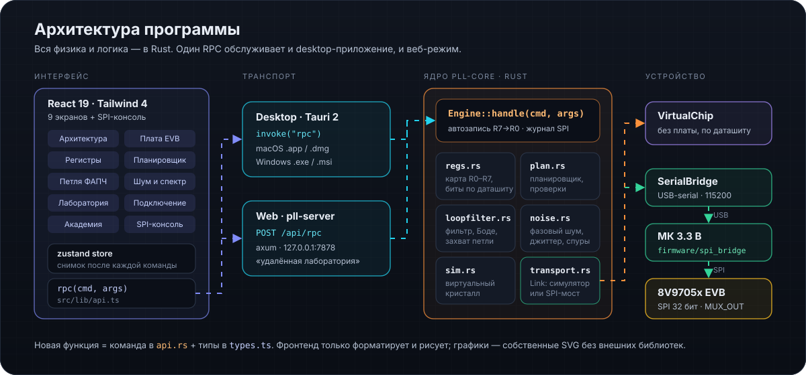

# Архитектура кода

Связанное: [CLAUDE.md](../CLAUDE.md) · [BUILD.md](../BUILD.md)

<p align="center">
  
</p>

```text
┌──────────────────────── интерфейс (src/, React 19 + Tailwind 4) ────────────────────────┐
│ views/*View.tsx  ·  components (ui, Plot, fields)  ·  lib/store.ts (zustand)            │
│                     rpc(cmd, args)  — lib/api.ts выбирает транспорт                      │
└───────────────┬──────────────────────────────────────────────┬──────────────────────────┘
       Tauri invoke("rpc")                               POST /api/rpc
┌───────────────▼──────────────┐                ┌──────────────▼──────────────┐
│ src-tauri (desktop)          │                │ crates/pll-server (axum)    │
│ состояние: app_config_dir    │                │ состояние: ~/.pll-studio    │
└───────────────┬──────────────┘                └──────────────┬──────────────┘
                └────────────── pll_core::Engine::handle ──────┘
┌─────────────────────────────── crates/pll-core ───────────────────────────────┐
│ regs.rs  plan.rs  loopfilter.rs  noise.rs  power.rs  sim.rs  transport.rs     │
└────────────────────────────────────────┬──────────────────────────────────────┘
                              trait Link │
                   ┌─────────────────────┴─────────────────────┐
             VirtualChip (sim.rs)                SerialBridge → firmware/spi_bridge → 8V97051
```

## pll-core

| Модуль | Ответственность |
|---|---|
| `regs.rs` | Таблица `FIELDS`: имя, регистр, биты, доступ (RW/RO/Sticky/Fixed), значение по умолчанию, русские название и описание, варианты, блок схемы, двойная буферизация. `defaults()` — значения по даташиту после сброса; `starter()` — рабочая стартовая конфигурация. Кодирование 12/16-битных FRAC/MOD/PHASE. |
| `plan.rs` | `derive()` — все производные величины (fPFD, N, fVCO, M0, шаг, фаза, окно LD, такт калибровки…) и список замечаний `issues` с привязкой к блокам. `plan()` — точный рациональный перебор вариантов настройки. |
| `loopfilter.rs` | Импеданс фильтра, разомкнутая/замкнутая петля, запас по фазе, `design()` по методике даташита, нелинейный переходный процесс (RK4). |
| `noise.rs` | Фазовый шум по вкладам, джиттер, спуры, виртуальный анализатор спектра. |
| `power.rs` | Ток по доменам питания, мощность, температура кристалла. |
| `sim.rs` | Виртуальный кристалл: записанные/активные регистры, применение буферов при записи R0, калибровка ГУН, захват, readback, sticky-флаги, температура, CE/MUTE. |
| `transport.rs` | Трейт `Link`; реализация для симулятора и последовательного моста; список портов; сканирование USB. |
| `api.rs` | `Engine`: настройки, регистры, авто-запись (только изменённые, R7→R0), журнал SPI с расшифровкой полей, снимок состояния, все RPC-команды. |

## RPC

Все команды — в `Engine::handle`. Мутирующие команды возвращают полный снимок (`Snapshot`), и фронтенд просто заменяет состояние. Основные группы:

- состояние: `get_state`, `get_meta`, `status` (опрашивается каждые 350 мс);
- регистры: `set_field(s)`, `set_register`, `apply`, `write_all`, `write_register`, `read_register`, `read_all`, `clear_sticky`, `reset_defaults`, `raw_transfer`, `export_config`, `import_config`;
- расчёты: `plan`, `apply_plan`, `tune`, `loop_analysis`, `design_loop`, `phase_noise`, `spectrum`, `power`;
- железо: `list_ports`, `scan_usb`, `connect`, `set_pins`, `sim_control`;
- журнал: `log`, `clear_log`; настройки: `set_settings`, `set_auto_apply`.

## Фронтенд

- `lib/store.ts` — единое хранилище: `snap`, `status`, журнал, текущий экран, выбранный блок, тосты, тема.
- `components/fields.tsx` — редактор любого поля по метаданным (сегменты, список, переключатель, число).
- `components/Plot.tsx` — собственные SVG-графики (лог-оси, вторая ось Y, маркеры, подсказка).
- `views/ArchitectureView.tsx` — SVG-схема (viewBox 1200×700); идентификаторы блоков совпадают с `FieldDef.block` и `lib/blocks.ts`.

## Как добавить функцию

1. Расчёт/логика — в подходящий модуль `pll-core` + тест.
2. Команда — ветка в `Engine::handle`.
3. Типы ответа — в `src/lib/types.ts`.
4. Вызов — `useStore().call("команда", {...})`; если команда возвращает снимок, состояние обновится само.
5. `make check`, запись в `CHANGELOG.md` → `## [Unreleased]`.
