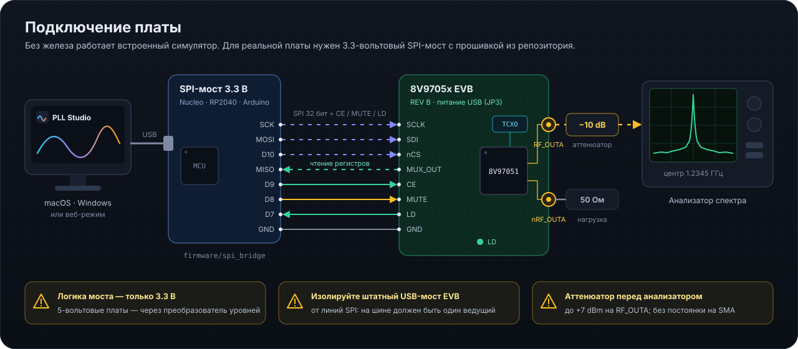

# Первый запуск с платой 8V9705x EVB

Связанное: [SPI-мост](SPI_BRIDGE_ru.md) · [README](../README.md)

  

## 0. Без платы

Запустите приложение (`npm run app` или установленный PLL Studio). По умолчанию включён **симулятор**: всё, что описано ниже, работает и без железа — удобно, чтобы освоиться.

## 1. Плата

Из коробки (по руководству EVB):

- стоит **TCXO 25 МГц** — внешняя опора не нужна;
- плата питается **от USB** — перемычка **JP3** в положении USB;
- выходы после включения **выключены** — их включает конфигурация.

Подключите:

1. USB-кабель — должен загореться индикатор питания.
2. **RF_OUTA** → анализатор спектра кабелем 50 Ом, лучше через аттенюатор 10 дБ.
3. **nRF_OUTA** — нагрузка 50 Ом (или второй вход для дифференциального измерения).

В приложении это же есть в разделе **«Плата EVB» → «Первый запуск»** (чек-лист сохраняется).

## 2. Подключение

Раздел **«Подключение»**:

- **Сканировать USB** — посмотрите VID:PID моста на плате (сообщите его, если хотите нативный драйвер).
- Для реальной записи регистров подключите **внешний SPI-мост** ([инструкция](SPI_BRIDGE_ru.md)), выберите порт и нажмите «Подключить».

После подключения при включённой **авто-записи** приложение сразу запишет текущую конфигурацию в порядке R7→R0.

## 3. Первая частота

1. **«Планировщик»** → введите `2450` (МГц) или выберите пресет.
2. В таблице вариантов первый — лучший по шуму. Нажмите **«Применить и включить RF_OUTA»**.
3. В верхней панели: RF_OUTA = 2 450.000 000 МГц, индикатор **«Захват»** зелёный; на плате загорается светодиод **LD**.
4. На анализаторе — несущая около +2 dBm (мощность меняется в «Архитектура» → блок OUT A).

## 4. Что изучить дальше

| Хочу понять | Куда идти |
|---|---|
| как частота опоры превращается в выходную | «Архитектура» → карточка «Уравнение синтезатора» |
| почему петля захватывается за десятки микросекунд | «Петля ФАПЧ» → «Переходный процесс» |
| откуда шум и спуры | «Шум и спектр»; сравните dither вкл/выкл |
| как ведёт себя калибровка ГУН | «Лаборатория» → свип и температура; «Регистры» → «По даташиту» (BAND_SEL_DIV = 1 ломает калибровку) |
| что на самом деле уходит по SPI | SPI-консоль (⌘/Ctrl + J) |

## 5. Петлевой фильтр вашей платы

Номиналы фильтра по умолчанию — расчётные. Найдите на плате RC-цепочку между выводами CP_OUT и VTUNE, запишите номиналы и введите их в **«Петля ФАПЧ» → «Текущий фильтр»** — от этого зависят все оценки шума и переходных процессов.

## Если что-то не так

| Симптом | Проверьте |
|---|---|
| «Нет захвата», VTUNE у края | такт калибровки 125–500 кГц (BAND_SEL_DIV), fPFD в пределах, CP не в Hi-Z |
| несущей нет, но захват есть | RF_OUTA_EN, MUTE, MTLD, CE |
| readback не совпадает | MUX_OUT должен быть SDO (111), провод MUX_OUT → MISO |
| SPI_ERROR в R7 | кадр не из 32 тактов: проверьте мост и частоту SCLK |
