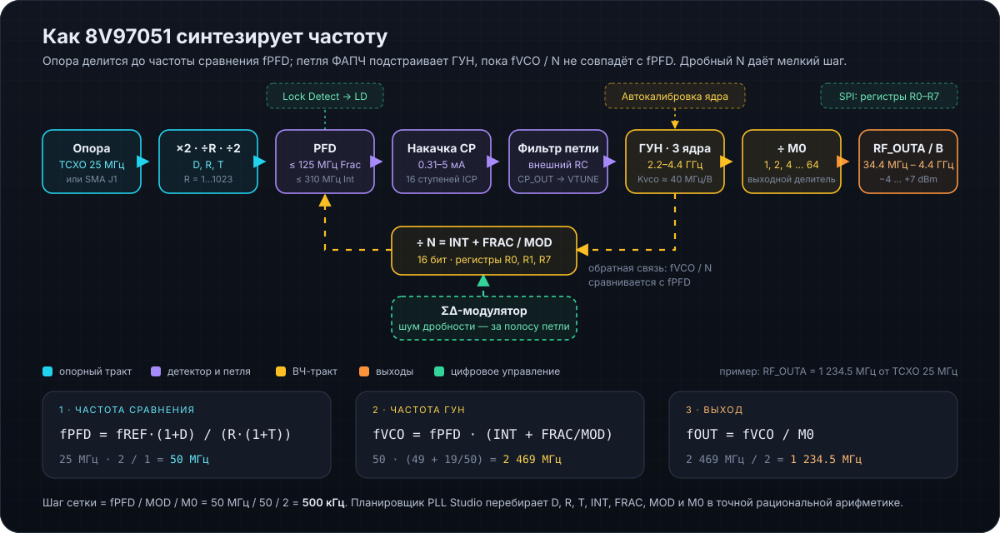

# Документация PLL Studio

Связанное: [README](../README.md) · [Сборка](../BUILD.md) · [Версии](../VERSION_MANAGEMENT.md) · [Изменения](../CHANGELOG.md) · [Безопасность](../SECURITY.md)

  

## Пользователю

| Документ | О чём |
|---|---|
| [Первый запуск с платой](FIRST_RUN_ru.md) | Питание, кабели, первая частота на RF_OUTA, что смотреть на анализаторе |
| [SPI-мост](SPI_BRIDGE_ru.md) | Прошивка для 3.3-вольтовой платы, схема подключения к EVB, протокол |
| «Академия» в приложении | 11 уроков: опорный тракт, PFD/CP, петля, ГУН, Frac-N/ΣΔ, выходы, Lock Detect, SPI, Fast Lock, шум |

## Разработчику

| Документ | О чём |
|---|---|
| [Архитектура кода](ARCHITECTURE_ru.md) | Крейты, RPC, симулятор, фронтенд, как добавить функцию |
| [Сборка](../BUILD.md) | macOS `.dmg`, Windows `.exe`/`.msi`, веб-сервер, CI |
| [Управление версией](../VERSION_MANAGEMENT.md) | `tools/update_version.py`, что синхронизируется |
| [Выпуск релиза](release_guide_ru.md) | Пошаговый чек-лист релиза |
| [CLAUDE.md](../CLAUDE.md) · [AGENTS.md](../AGENTS.md) | Правила для ИИ-агентов |

## Первоисточники

- Даташит 8V97051 (Renesas, «8V97051 Datasheet») — регистры, ограничения, методика расчёта петли.
- «8V9705x Evaluation Board User Guide» — плата, перемычка JP3, питание от USB, TCXO 25 МГц.
