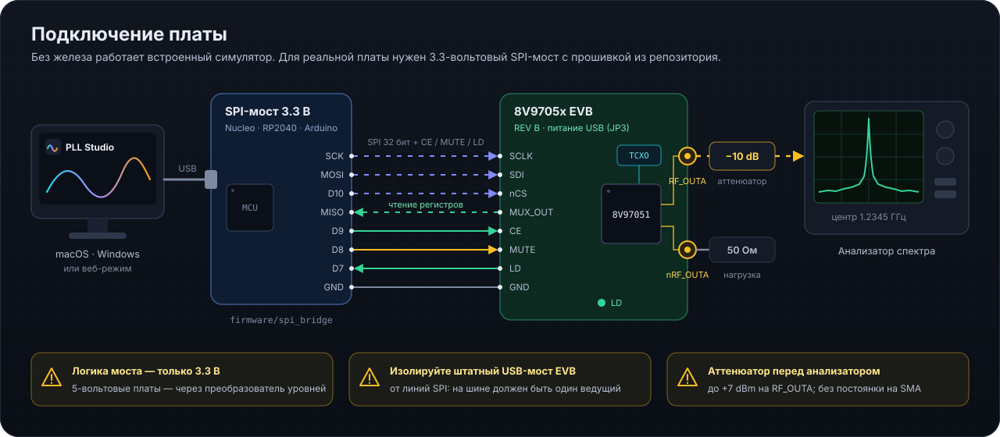

# SPI-мост: прошивка, подключение, протокол

Связанное: [Первый запуск](FIRST_RUN_ru.md) · [SECURITY.md](../SECURITY.md) · прошивка [`firmware/spi_bridge/spi_bridge.ino`](../firmware/spi_bridge/spi_bridge.ino)

По схеме EVB Rev A штатный путь — **FTDI U5 → I²C → SC18IS602 U4 → SPI**; он поддерживается экспериментальным [штатным USB-транспортом PLL Studio](NATIVE_USB_ru.md). Ниже описан альтернативный внешний мост. Для внешнего моста на macOS и Windows используйте плату с **логикой 3.3 В** и ядром Arduino как последовательный SPI-мост.

  

## Подходящие платы

STM32 Nucleo (STM32duino, виртуальный COM через ST-LINK), Raspberry Pi Pico (arduino-pico), ESP32, Arduino Zero / Due / Nano 33.

> ⚠️ Входы SPI кристалла — логика 1.8 В, толерантны к 3.3 В. **Не подключайте 5-вольтовые Uno / Mega / Nano** без преобразователей уровня.

## Прошивка

1. Arduino IDE 2 или PlatformIO, установите ядро вашей платы.
2. Откройте `firmware/spi_bridge/spi_bridge.ino`, при необходимости поменяйте пины (`PIN_NCS`, `PIN_CE`, `PIN_MUTE`, `PIN_LD`).
3. Загрузите. В мониторе порта (115200) команда `?` должна вернуть `PLLBRIDGE 1.0 <плата>`.

## Подключение

| Мост | 8V97051 / EVB | Примечание |
|---|---|---|
| SCK | SCLK | до 20 МГц |
| MOSI | SDI | |
| D10 | nCS | защёлкивание по фронту |
| MISO | MUX_OUT | для чтения задайте MUX_OUT = 111 (SDO) — так сделано в стартовой конфигурации |
| D9 | CE | необязательно |
| D8 | MUTE | необязательно, 0 = выходы заглушены |
| D7 | LD | необязательно |
| GND | GND | обязательно |

**Изолируйте штатный USB-контроллер EVB от линий SPI**: на Rev A эти линии непосредственно ведёт U4 SC18IS602. До подключения внешнего ведущего обеспечьте изоляцию его выходов SCLK, SDI и CSB. JP1/JP2 — MUTE/CE, JP3 — выбор питания; их снятие не изолирует SPI. Способ изоляции и состояние выходов при сбросе нужно проверить по документации U4 и схеме вашей ревизии; одного отключения USB недостаточно считать изоляцию подтверждённой. Схема подключения также нарисована в приложении: «Подключение» → «Схема подключения внешнего моста».

## Протокол

115200 8N1, одна команда на строку, ответ заканчивается `\n`.

| Команда | Ответ | Действие |
|---|---|---|
| `?` | `PLLBRIDGE 1.0 <board>` | идентификация |
| `X hhhhhhhh` | `OK hhhhhhhh` | один 32-битный кадр SPI (mode 0, MSB first); в ответе — MISO |
| `CE 0\|1` | `OK` | уровень CE |
| `MUTE 0\|1` | `OK` | уровень MUTE (0 — заглушить) |
| `LD` | `OK 0\|1` | чтение LD |
| `SPI <hz>` | `OK` | частота SCLK |

Ошибки: `ERR <текст>`.

## Чтение регистров

PLL Studio читает регистр n так: запись R7 с `SPI_R_WN = 1` и `READBACK_ADDR = n`, затем следующий 32-тактовый кадр возвращает значение на MUX_OUT. Если MUX_OUT не в режиме SDO, приложение временно переключает его и возвращает обратно. Результат сравнения видно в «Регистры» (`readback ✓` / `≠`).

## Свой мост

Любое устройство, реализующее протокол выше, работает с PLL Studio. Штатный USB реализован отдельно в `crates/pll-core/src/transport/evb.rs`; он не использует текстовые команды PLLBRIDGE. Совпадение VID:PID не удостоверяет модель платы.
